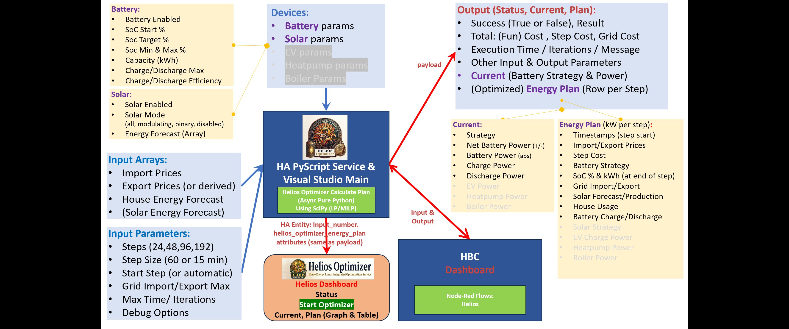
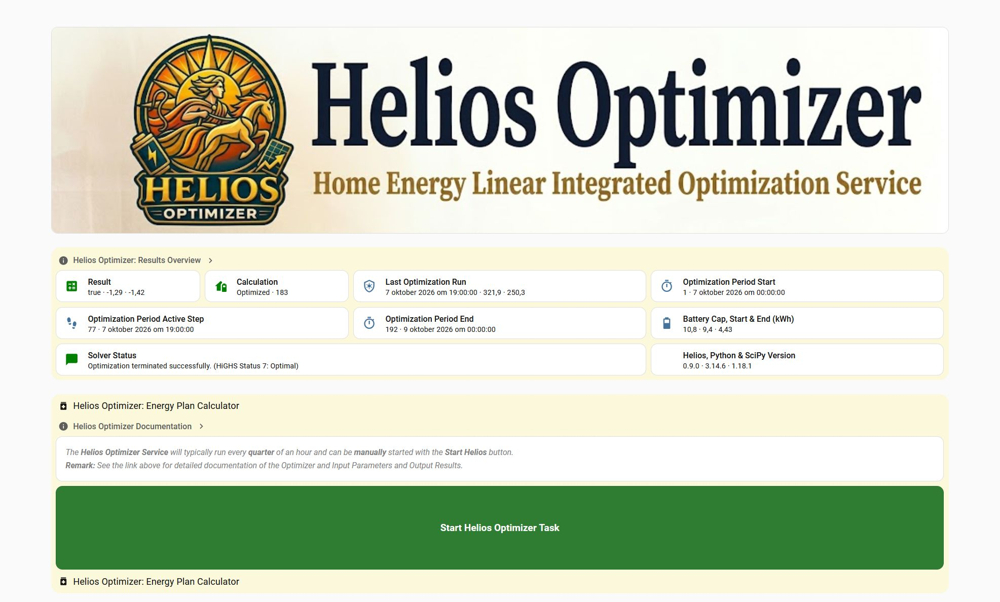
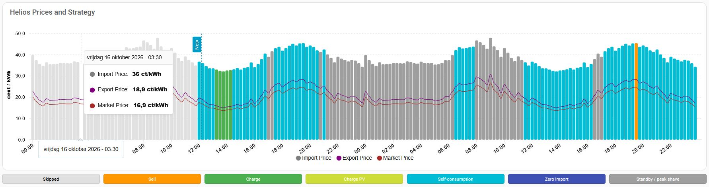
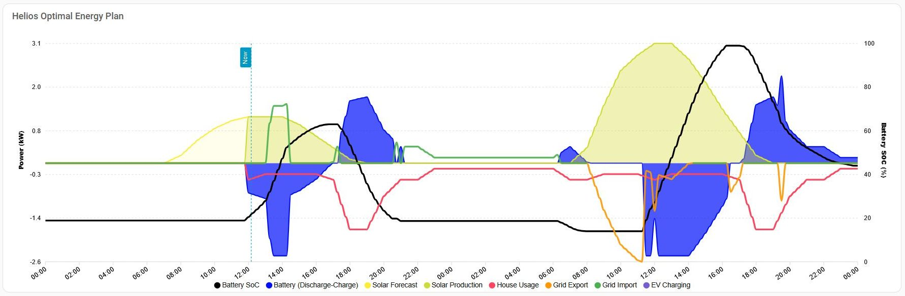

# Helios Optimizer - Documentation

[README](README.md) - **Doc** - [Why LP](WHY.md) - [Install](INSTALL.md) - [Release Notes](RELEASE_NOTES.md)

## Table of Content
- [Intro](#intro)
- [Overview](#overview)
- [Why use a Linear Programming Model](#why-use-a-linear-programming-model)
- [Description](#description)
- [How It Works: The Energy Model](#how-it-works-the-energy-model)
- [Execution and Architecture](#execution-and-architecture)
- [Helios Dashboard (Input and Output)](#helios-dashboard-input-and-output)
- [Input Parameters](#input-parameters)
  - [Optimization Parameters](#optimization-parameters)
  - [Advanced Parameters](#advanced-parameters)
  - [Battery Parameters](#battery-parameters)
  - [Why a Horizon of 48 hours and a SoC Target](#why-a-horizon-of-48-hours-and-a-soc-target)
  - [Derived Parameters](#derived-parameters)
  - [HBC Settings](#hbc-settings)
- [Output](#output)
  - [Results Summary](#results-summary)
  - [Actuals for Current Step](#actuals-for-current-step)
  - [Prices and Strategy Graph](#prices-and-strategy-graph)
  - [Optimal Energy Plan Graph](#optimal-energy-plan-graph)
  - [Optimal Energy Plan Table](#optimal-energy-plan-table)
- [Insight Details](#insight-details)
  - [Optimization State](#optimization-state)
  - [Solar and Battery Information](#solar-and-battery-information)
  - [Optimization Run](#optimization-run)
  - [Energy Plan Totals](#energy-plan-totals)
- [Solar Forecast Configuration](#solar-forecast-configuration)
- [Fuse Box Limits](#fuse-box-limits)
- [Installation](#installation)
- [Release Notes](#release-notes)
- [License](#license)

## Intro
The **HELIOS Optimizer Service** is a **H**ome **A**ssistant **PyScript** application designed to 
calculate an **Optimal Energy Plan** for your house for typically 2 days.

To find the financially **Optimal** Energy Management **Strategy** for charging, discharging and solar production,
it looks at dynamic electricity prices, solar forecasts, battery storage and expected household energy usage.

For **each step** (of an hour or 15 minutes) it will determine the best **Battery Strategy**
(**Sell**/Discharge, **Charge**/Buy, **Charge PV**, **Self-consumption (NOM)**, **Zero import** or **Standby**).
It will take into account: energy import and export prices, maximum and minimum state of charge (SoC) of the battery, target SoC at the end of the optimization period,
efficiency of battery charging and discharging, prediction of the solar production during the day(s) and the energy usage distribution over the day.
It calculates for each step the costs for import, export and battery discharging and searchs very quickly
for a solution with the minimum total cost for all steps while respecting all restrictions specified.
A typical optimization period/horizon is from the current time today to the end of the day tomorrow.
The Helios Optimizer will run again every 15 minutes so it will adapt automatically to changing circumstances 
(e.g. different battery SoC due to actual house usage and solar production).

Two **graphs** are provided that give an insight in the selected strategies per step, the battery state of charge and the power usage.
Use the documentation **links** above each section to get more details (as described below) about the inputs and results.

An **important observation** is that Helios Optimizer calculates an Energy Plan 
but does **not** directly interface with your devices (Batteries and Solar Invertors)!
It does provide an interface with **Home Battery Control (HBC)** and includes a **Node-Red** *Helios Strategy Flow* to connect
the Helios Energy Plan with the HBC Battery Management. 
As a result all rules that you define in HBC 
(e.g. SoC Min/Max, Max Power, Peak shaving, Battery Balancing) will always be followed.
The NR Helios Strategy will just read the Helios Strategy and will activate the related HBC Sub-Strategy.
Please be aware that due to a restriction in HBC the charging and discharging in HBC is always at maximum power
which may not always be equal to the optimal power level calculated by Helios Optimizer.
Initially the Battery parameters for Maximum Power and SoC Minimum and Maximum will be copied 
from HBC but it you change these afterward you need to adapt the Helios Input parameters aswell.
Battery SoC and Capacity (Maximum Energy) will be automatically taken from HBC settings.

The optimization is based on a **Mathematical Model** and uses **Linear Programming** to determine the **Optimal Energy Plan**. 
The Model uses **SciPy**, a Python Scientific Computing Library, to solve the linear programming calculations.

## Overview

## Why use a Linear Programming Model
See [Why use Linear Programming?](WHY.md#why-use-lp-en) or [Waarom Lineair Programmeren gebruiken?](WHY.md#waarom-lp-gebruiken-nl).

If you want to know more about the formulas used in the model and you can read dutch see: 
[Optimale Energie Plan met LP](https://github.com/Jos1958/ha-helios-optimizer/blob/main/docs/OptimaleEnergiePlan_LP.md)

## Description
Helios calculates an optimized energy plan for a specified horizon (typically 2 days)
by finding the optimal power setpoints (for battery charge/discharge, grid import/export and solar production) for each step in the optimization period.
The most important optimization rule defines that the Total Power Supply (Discharge, Import and Solar Production) and the Total Power Demand (Charge, Export and House Usage) must be equal in each step.
The Battery State of Charge (SOC) will be kept between the Minimum and the Maximum SOC Percentages in each step and at the end of the optimization period above the Target SOC.
In addition the model will keep the Charge/Discharging Power below the Battery Charge/Discharge Limit values and the Import/Export Power below the Maximum Grid Import/Export values.
Solar Production will be equal to the Solar Forecast unless the Solar Inverter can be Modulated (Dimmed) or Turned On and Off.
 
The planning horizon is defined by the number of steps and the step duration in minutes.
For example: 48 steps of 60 minutes or 192 steps of 15 minutes both optimize a 2-day period.
 
Grid Import and Export Prices, Solar Energy Forecast and House Energy Forecasts are needed as Input Arrays, containing values for every step in the period.
HBC Price Data can be used as an alternative source for the Import and Export Price arrays.
House Daily Usage and Distribution can be provided as an alternative source for the House Energy Forecast array.
 
Total Energy Cost is the sum of energy costs per step (calculated for Grid Import and Export Power).
To compensate for battery depreciation cost a discharge (default 0.01 euro) and charge cost (default 0.00) is included in the Total Energy Cost.
A cost for charging and/or discharging will also prevent the model from charging and discharging at the same time.
The optimizer aims to MINIMIZE the Total Energy Cost over the entire horizon.
Note: Negative costs may occur when exporting energy to the grid or during negative import prices.
 
Note: Without a battery or deferrable loads, optimization opportunities are limited
since a strict power balance between consumption, import, and export must be met in each step.
 
The optimization horizon always starts today (and optionally extends to the following days).
By default (with a start step of 0), the active start step is calculated based on the current time.
Optionally, a specific start step can be defined (e.g., step 1 to start at 00:00) but this is mainly meant for (regression) testing.
All input arrays must start at 00:00 today so the optimizer can align prices and forecasts correctly.
Again for (regression) testing purposes a specific optimizer timestamp can be provided that runs the optimizer for a specific date and time (instead of for the current date and time).
 
The resulting Optimized Energy Plan determines the active strategy for the current step
(e.g., NOM, Buy, Sell, Charge, Discharge, Disabled) and provides real-time setpoints
to steer the Battery Charge/Discharge, the Solar Production and (in the future) the Deferrable Loads.

### How It Works: The Energy Model
At the core of the optimizer is a physical and financial Energy Model. For each discrete time step in the optimization period (e.g., 15-minute or 1-hour intervals over 24–48 hours), the model solves a system of linear equations and constraints:
- **Energy Balance:** Ensures that at every time step, Total Power Supply (Grid Import + PV Production + Battery Discharge) equals Total Power Demand (House Load + Grid Export + Battery Charge), accounting for round-trip efficiency (RTE) of the battery.
- **Objective Function:** Minimizes net **Energy Costs** (or maximizes financial return) over the entire horizon, taking into account Dynamic Import and Export Prices, Battery Capacity and Grid and Battery Power limits.
- **Optimal Variables:** Output values are generated for Target Battery Strategy with Charge/Discharge Power and an optional PV Strategy (Modulating/Dimming or On/Off) Strategy for each step.

### Execution and Architecture
The current version runs as a PyScript Service installed in your pyscript/ folder. Pure Python modules are in the pyscript/helios_python folder.
For maximum performance, the calculation (including LinProg) runs asynchronously in a native Python thread, 
computing a full 48-hour plan in under 500ms without blocking Home Assistant.
Testing is done on a Home Assistant Operating System (HAOS) Mini-PC (with NUC: Intel Celeron J4105 CPU @ 1.50Ghz, 8Gb, SSD: 512Gb).
Feedback on the performance on other Home Assistant Environments is welcome.

**Important Note on Hardware Control**:
HELIOS Optimizer acts purely as the **Planning and Decision Engine**. 
It does **not** communicate **directly** with your Inverters, Batteries, or Smart Meters. 
Instead, it exposes Target State and Power Values back to Home Assistant. 
Physical control of hardware—such as setting charge/discharge rates or managing safety limits—is handled 
by external automation frameworks like **House Battery Control (HBC)**, **Node-RED** flows or other Home Assistant integrations.
To maintain high performance the model aggregates all available battery storage 
into a single virtual battery with combined total capacity (kWh), maximum charge/discharge rates (kW), and average round-trip efficiency.
Individual battery management—such as balancing states of charge (SoC) or routing power between multiple physical batteries 
(e.g., dual Marstek Venus units)—is offloaded to the execution layer (HBC or custom automations), 
which receives the total target power from Helios and distributes it across the physical units.

**Future releases** will migrate the PyScript architecture into a standalone Home Assistant Custom Component.

## Helios Dashboard (Input and Output)

At the top of the dashboard a short **Overview** of the Optimizer Results is displayed. 
Below that are the **Input Parameters** and more **Detailed Results** of the calculated Optimized Energy Plan (e.g. Status Blocks, Graph and Table).
<i>The **Helios Optimizer Service** will typically run every **quarter** of an hour 
and can be **manually** started with the green **Start Helios** button. 

## Input Parameters

### Optimization Parameters
- **Step Size:** Size of Each Step in Minutes (Use 15 or 60 minutes)
- **Max Grid Import:** Maximum Grid Import Power in kW 
   This is the Import limit for your **fuse box** (all phases together) and not directly related to the battery limits.
   See [Fuse Box Limits](#fuse-box-limits) for common connections and their power capacity
   **Remark:** A low maximum grid import (or export) value can make the energy plan infeasible since a power balance must always be maintained.
- **Max Grid Export:** Maximum Grid Export Power in kW
   This is the Export limit for your **fuse box** (all phases together) and not directly related to the battery limits.
- **House Daily Usage (Average):** Average Daily Energy Usage in the House (kWh)
   In the future the House Energy Usage will be retrieved from history data but at the moment you need to make an estimate for the average energy usage in the house. 
   See the advanced parameters section if you want to change the distribution of the daily usage over the day.
   Large energy users (EV, WP and Boiler) will be optimized separately in the future and will have to be excluded from the house usage but for now you may want to **include** them in the house usage. 
   **House Usage** (kWh) = Grid Import - Grid Export + Battery Daily Discharge - Battery Charge + Solar Production (all in kWh per Day)
   **Warning:** This is NOT the energy retrieved from the Grid!
- **Solar Mode:** Solar Panel Inverter Mode 
  - All: Solar Production Energy in a step is equal to the Solar Forecast Energy for the step
  - Modulating: Solar Production can be from Zero (0kWh) to the Solar Forecast Energy for the step
  - Binary: Solar Production can be ON (=Solar Forecast Energy) or OFF (0kWh) for the step
  - Disabled: Solar Production Disabled (0kWh) in each step
- **Solar Forecast Source:**
  - **Forecast.Solar Integration** (**Preferred**): Use this option if you have the Forecast.Solar Integration installed and configured.
   Helios will retrieve the Solar Forecast Array using a service provided by the Forecast.Solar Integration!
  - **Forecast.Solar REST api** (Alternative): Use this option if you want to retrieve the Solar Forecast Array directly from the internet using a REST api.
   See [Solar Forecast Configuration](#solar-forecast-configuration) for more information.

### Advanced Parameters
Enable the **'Helios Insight Mode'** to make these **advanced** parameters visible.
- **Days:** Optimization Horizon (0=Disabled, 1=Today, 2=Today and Tomorrow)
   **Important Remark:** The Advised Optimization Period/Horizon is **2 Days** 
  (e.g. *48 steps of 60 minutes* or *192 steps of 15 minutes*)!
   The optimization model performs best with a 2-day horizon because it begins modeling from the current time of day. 
  Since optimization starts immediately, a 1-day horizon initiated at 22:00 would only cover a 2-hour window, which is rarely useful.
-  See for details [Why a 48 hours horizon and a SoC Target](#why-a-horizon-of-48-hours-and-a-soc-target).
    **Start Step:** Start the Optimization in the specified step (0..Steps). 
   **Important:** Typically use a value of **Zero** (0) since the Optimization will determine the start step **automatically** based on the current time!
   All steps prior to the Start Step are **Skipped**. Therefore starting at the **current** time (by setting the start step to 0) is the logical choice to begin the optimization.
   Other Start Step values are **only** to be used for (Regression) **Testing** or Simulation Runs of the Optimizer!

- **House Daily Usage Distribution (24 Hours):** 
   How is the energy usage spread over the day (an array of 24 values, 1 value for each hour of the day).
   Each value represents only the relative energy usage for a specific hour during the day and not the exact energy usage.
   If you specify 1 for the first hour (00:00-01:00) and 3 for the 7th hour (06:00-07:00) this only means that you are using 3x times more energy in the 7th hour.
   Remark: The sum of the 24 numbers does not have to be the same as the daily usage.

- **Price Type used in HBC:** Specify which Price Type is used for the **Tarif Data Source** in HBC.
   Helios will derive the other prices from the **HBC Dynamic Price Data** and needs to now which Price Type is used in HBC.
  - **Import** Prices (**Default**): Price applicable for importing energy from the grid (ct/kWh) 
  - **Export** Prices: Price applicable for exporting energy from the grid (ct/kWh) 
  - **Market** Prices: Import and Export Prices are based on the Market Price which does not contain taxes, provider markup etc..
- **Price Data Provider:** Specify which Source Provider has been used to retrieve the HBC Price Data.
The default value will be the **'HBC Data Source'** as selected in HBC for the **Tarif Data Source** but you may want to manually overwrite the Source (Data) Provider.
- **Energy Provider (Contract):** Specify which Target Provider you want to use to calculated the prices for the Optimizer.
The default value will be the **'HBC Data Source'** as selected in HBC for the **Tarif Data Source** but you may want to manually overwrite the Target (Energy) Provider.
If you are using a Generic Data Provider in HBC (with marketing prices) then you **must** adapt the **Energy Provider** since otherwise
you will have import and export prices without Energy Tax, VAT and Provider Markups. 
Use your Country if your own provider is not available in the list.
Use the Custom Provider if your own provider and country are not available or when the resulting prices are incorrect.
In the near future the settings (energy tax, vat, markups and loss factors) of the Custom Provider will be customizable. 
 See the [Frequenty Asked Questions](docs/FAQ.md) for a discussion about '**Prices** in Helios Optimizer are **not correct**'.

- **Net Metering (Saldering 2026):** By Enabling Net Metering the Export Prices will include Energy Tax (this is only sensible as long as the Net Metering is applicable in the Netherlands, obsolete starting 2027)
  
### Battery Parameters
- **Battery Enabled:** Enabled or Disabled Batteries, when disabled the battery will not be used by optimizer
- **Battery SoC Target:** Target Battery State of Charge Level at the END of the optimization period.
   Pick a reasonable target percentage (40%-50%) that is needed at the end of a two day optimization period.
   This value is only valid for the end of the optimization period (not for the end of the first day) and will 
  make sure that the optimizer does not empty your battery to maximize the profit.
- **Battery SoC Min:** Minimum Battery State of Charge Level which is valid at EACH step  
- **Battery SoC Max:** Maximum Battery State of Charge Level which is valid at EACH step  
- **Battery Charge Limit:** Maximum Power that can be used to Charge the Battery or Batteries (Limit applies to **all** batteries together)
- **Battery Charge Limit:** Maximum Power that can be used to Discharge the Battery or Batteries (Limit applies to **all** batteries together)
- **Battery Discharge Limit:** Maximum Discharge Limit for **all** of the batteries together
- **Battery Charge Efficiency:** Efficiency Factor for Charging the Battery
   This factor 0.70-1.00) determines how much energy is lost while charging the battery.
   For example: 4kWh is sent to the battery, charge factor of 0.9, SOC is increased with 3.60kWh (=0.9 x 4kWh).
- **Battery Discharge Efficiency:** Efficiency Factor for Discharging the Battery
   This factor 0.70-1.00) determines how much energy is lost while discharging the battery.
   For example: 4kWh is retrieved from the battery, discharge factor of 0.9, SOC is decreased with 4.44kWh (=4kWh / 0.9).
   Remark: Round Trip Efficiency (RTE) is Charge Efficiency * Discharge Efficiency (e.g. 0.81 = 0.9 x 0.9)

### Why a horizon of 48 hours and a SoC Target
When running an Energy Optimization Model it is important to use a least a **48-hour horizon**
and a **State of Charge (SoC) Target** for several mathematical and operational reasons:

1. **Mathematical Boundary Conditions (Preventing Edge Effects):**
A linear programming (LP) solver optimizes decisions across a finite time window (48 hours). 
Because the solver's world abruptly ends at hour 48, it suffers from a "finite horizon effect" at the edge of the window:
Without a terminal SoC target, the optimizer treats the final hour of the period as the absolute end of the battery's lifecycle.
To maximize short-term financial gain within the window, 
the solver might aggressively empty the battery completely by hour 48, leaving you with a depleted battery for hour 49 (which falls outside the current optimization scope).

2. **Ensuring Operational Continuity:**
Energy optimization is a rolling, continuous process (re-calculated as new price data becomes available). A
target SoC at the end of the horizon acts as a vital bridge to the next optimization cycle. 
It ensures that the battery transitions smoothly into the subsequent hours without unexpected depletion or erratic jumps in state.

3. **Balancing Present Savings Against Future Needs:**
A 48-hour horizon gives the algorithm the foresight to plan across today and tomorrow's market peaks and valleys. 
However, without an end-SoC constraint or target:
The model might consume all stored cheap energy today, ignoring that 
tomorrow morning might feature even higher grid prices or a delayed solar startup.
 etting a target allows you to dictate the desired energy reserve at the end of the window, ensuring the system leaves enough buffer for upcoming morning loads or reserves capacity for tomorrow midday's solar surplus.

**Summary:**
While the 48-hour horizon provides the necessary foresight to exploit price fluctuations, the SoC target acts as the anchor. 
It prevents the optimizer from draining the battery prematurely at the edge of the calculation window and guarantees a safe, 
predictable transition into the next optimization run.

### Derived Parameters
The parameters in this section are retrieved from Helios and cannot be changed by the user.
They are displayed only for validation purposes:
- **Helios Version:** Latest installed version of Helios
- **Steps:** Optimization Steps which is derived from Optimization Days and Step Size 
   (0=Disabled, 24 x 1 Hour, 48 x 1 Hour, 96 x Quarter, 192 x Quarter of a Hour) 

The following parameters should represent the (total) values for **all** HBC batteries and calculated based on HBC Marstek Entities using Helios **Templates**.
They are used as input for the Helios Optimizer:
- **Maximum Energy (All Batteries):** Total Energy that can be stored in the HBC Batteries (Sum of all batteries)
- **Remaining Energy (All):** Remaining Energy in the HBC Batteries (Sum of all batteries)
- **Total SOC (All):** State of Charge for all of the HBC Batteries (Remaining Energy / Maximum Energy)

The following parameters are Helios Entities for HBC which are **derived** from the Helios Optimal Energy Plan and are used by the Helios Strategy in HBC:
- **HBC Sub Strategy by Helios:** The current Sub Strategy as calculated by Helios for HBC
- **HBC Net Power for Battery by Helios:**  The current Net Battery Power as calculated by Helios for HBC

Every time when the Helios Optimizer is run these HA Entities are updated.
The Helios Strategy Flow in HBC will pickup these field and makes them available to the Executions section of the flow.
The Home Battery Start flow will call this executor (in Call "Link in" node) and will further process the selected Sub-Strategy.
The Net Power value is provided to HBC with a value calculated by Helios (for Charge/Buy and Discharge/Sell) but HBC can only charging and discharge at maximum power. 
For the other Sub-Strategies (e.g. Self-consumption, Zero import, Standby / peak shave and Charge PV) the Net Power value is not applicable/needed.

### HBC Settings
The parameters in this section are configured in or calculated by HBC and cannot be changed here.
Since they are already compensated for the required minimum and maximum state of charge they cannot be used by Helios.
Instead the values calculated using Helios templates based on the Marstek entities (as described in the section above) are used by Helios.
- **Battery Count**: Number of Batteries available in HBC
- **Max Available Energy**: Maximum Available Energy (Capacity minus minimum), not used by Helios
- **Available Energy**: Current Available Energy (Remaining minus minimum), not used by Helios

 The Max Charge/Discharge and Target SOC-s are **copied** to the Helios Battery Parameters at installation time.
 **Warning:** When these fields are updated in HBC after installation of Helios they will **NOT** be copied again to the Helios Battery Parameters!
- **Max Charge Power (All):** Maximum Charge Power (Sum of Max Charge Power per Battery)
- **Max Discharge Power (All):** Maximum Discharge Power (Sum of Max Discharge Power per Battery)
- **HBC Sell Target SOC%:** Overall Target State of Charge when discharging the batteries
- **HBC Charge Target SOC%:** Overall Target State of Charge when charging the batteries 

## Output

### Results Summary
- **Result:** Successful or Not (True or False), Total Cost, Grid Cost (Total Cost without Battery Cost)
- **Calculation:** Calculation Result (e.g.: Optimized, Infeasible, Exception, Balance Error, ...), Solver Iterations
- **Last Optimization Run:** Date and Time of the Last Run, Excecution Time, Lineair Programming Time (SciPy LP) 
- **Optimization Period Start:** Start Step, Date and Time for the Optimization Start 
- **Optimization Period Active Step:** Active Step (for Current Time), Date and Time for the Current/Active Step
- **Optimization Period End:** End Step, Date and Time for the Optimization End
- **Battery:** Battery Capacity, Start and End State of Charge (SOC), all in kWh 
- **Solver Status:** Solver (SciPy LP) Message or other Error Message
- **Versions:** Helios, Python and SciPy Software Levels (e.g. 1.0.0 - 3.14.6 - 1.18.1) 

### Actuals for Current Step
- **Active Step:** Current Step Number (1..N) based on Current Time which is at or after the start of the current step but before the start of the next step.
- **Step Start Time:** Start time of the current step.
- **Per Component:** State and Power for the current step.
  - **Helios Strategy:** Current Strategy as calculated by the Helios Optimizer.
  - **HBC Sub Strategy:** Current HBC Sub-Strategy derived from the Helios Strategy.
  - **Net Battery:** Charge or Discharge or Standby, Net Battery Power (Charge - Discharge)
  - **Grid Power:** Import or Export or NOM, Net Grid Power (Import - Export)
  - **Solar Production:** Active or Standby, Solar Inverter Production Power
  - **House Usage:** Active or Standby, House Demand Power 
  
  - **Charge Limit:** Active or Disabled, Maximum Battery Charge Power (step independent)
  - **Discharge Limit:** Active or Disabled, Maximum Battery Discharge Power (step independent)
  - **Max Grid Import:** Active or Off-Grid, Maximum Grid Import Power (step independent)
  - **Max Grid Export:** Active or Disabled, Maximum Grid Export Power (step independent)

### Prices and Strategy Graph

The Prices and Strategy Graph displays the **Import Prices** (as columns) and the related **Export** and **Market Prices** (as 2 lines).
These prices are retrieved from the **HBC Price Data** (which contains only Import Prices).
Export and Market Prices are calculated from the Import Prices using the Energy Tax (Energie Belasting), VAT (BTW) and the Provider Import and Export Markup (Opslag).

 **TODO:** These values will be configurable in the near future, specify a more detailed formula here.

The colors of the Import Price columns represent the selected **HBC Sub-Strategy**:
- **0=Skipped:** Steps in the past (before start step) are skipped.
- **1=Sell:**  Sell Energy **from** the Battery **to** the Grid.
- **2=Charge:** Charge **to** the Battery **from** the **Grid** Energy (and optionally with **Solar** Energy).
- **3=Charge PV:** Charge the Battery with **Solar** Energy **only**. Use the battery to prevent export to the Grid where possible but do not Discharge the Battery. Can be used even during the night when the Battery is below the minimum SoC (and Self-consumption is not an option).
- **4-Self-consumption:** Use the Battery to **prevent** **Import** from and **Export** to the Grid (is the same as **N**ull **O**n **M**eter).
- **5=Zero import:** Use the Battery to **prevent Import** from the Grid where possible but do not Charge the Battery.
- **8=Standby / peak shave:** Battery is on **Stand-by** but will try to **prevent power peaks** when peak shaving is enabled.

### Optimal Energy Plan Graph

The Optimal Energy Plan Graph displays the most important Output of the Helios Optimizer combined into one Graph.
 It represents the optimizer results for each step of a two day horizon:
- **SOC Percentages** (the black line) for the Battery (or for the sum of All Batteries)
 The **State of Charge** of the Battery at the **END** of each **Step**!
- **Power** values during the step:
  - **Battery** (Discharge - Charge) 
  - **Solar** Forecast and Production
  - **House** Usage 
  - **Grid** Import and Export

**Positive Power** values (above the X-as) indicate that power is made available to the House (Battery Discharged, Solar Production or Imported) and 
**Negative Power** values (below the X-as) indicate that power is used (Used in the House, Battery Charged or Exported).
 The **left** Y-as is for the Power values (kW) and the **right** Y-as is for the SOC Percentages (0-100%). 
 
**Warning:** Occasionally the browser page content with the Helios Energy Plan Graph may need to be manually refreshed (Ctrl-F5) before the graph is updated or is even displayed or is using the full window width.
Full Window width problems may also be resolved by resizing the Browser Window or going into Edit of the Dashboard and close without changes.
Tips how to fix this issue are welcome.

### Optimal Energy Plan Table
The Results Table lists all (power, energy, soc and cost) variables as calculated (or used) by the Optimization Model for every step of the optimization period (horizon):
- **Start Time:** Start Time of the Step in HH:MM (Today or Tomorrow)
- **Import Price:** Import Price for Importing Energy from the Grid
- **Export Price:** Export Price for Exporting Energy to the Grid (when negative you are paying for exporting)
- **Market Price:** Market Price is the Energy Price without Energy Tax, VAT and Provider Markup
- **Fun Cost:** Cost per Step for Importing, Exporting (usually negative) and Discharging
- **House Forecast:** Power used by the House as forecasted (based on House Usage and Distribution)
- **House Usage:** Power used by the House (same as forecasted but 0 for skipped steps since these are not included in the model)
- **Solar Forecast:** Power produced by the Solar Panels as forecasted 
- **Solar Production:** Power produced by the Solar Panels (usually same as forecasted but 0 for skipped steps, when solar turned off or less when solar production dimmed)
- **Strategy:** Strategy as calculated by the Helios Optimizer
- **HBC Sub-Strategy:** Home Battery Control Sub Strategy derived from the Helios Strategy (HBC has less strategies and strategies with different names)
- **SoC%:** State of Charge Percentage at the **END** of the step
- **SoC (kWH):** State of Charge in kilo Watt Hours (Battery Remaining Energy derived from the battery capacity and SoC%)
- **Grid Net (kW):** Grid Import Power minus Grid Export Power in kilo Watt
- **Charge (kW):** Battery Charge Power in kilo Watt
- **Discharge (kW):** Battery Discharge Power in kilo Watt 
- Battery Net Power: Battery Charge Power - Battery Discharge Power; Positive when charging and negative when discharging
- Battery Power: Absolute value of Battery Net Power; Always positive

## Insight Details
Enable Helios Insights Mode to make the following outputs visible.

### Optimization State
**TODO:**

### Solar and Battery Information
**TODO:**

### Optimization Run
**TODO:**

### Energy Plan Totals
**TODO:**

## Solar Forecast Configuration
There are currently two options to configure the Solar Forecast information.
If you already have Forecast.Solar Integration setup then you can use the data available in the Integration.
There is not an entity available with the Solar Production Forecast per hour but the data can be retrieved by Helios using a service of the Forecast.Solar Integration.
 
The alternative (more complex) option is to configure your own REST api in the optional helios_optimizer_forecast.yaml.
 Adapt the yaml to your own setup (location, declination (angle), azimuth - 180 (direction) and peak-power) and copy the yaml to the packages folder.
 See the [Forecast Solar Documentation](https://doc.forecast.solar/) for details.
 A template is included in the yaml file that converts the raw data from the api into the hours data that Helios requires.

The Helios Optimizer requires a Solar Forecast Array that matches the step size and total number of steps specified in the input parameters.
If the forecast is only provided for today while you are optimizing a two-day horizon, the array will be automatically extended to two days by repeating the final day's data.
Similarly, if the step size is incorrect (e.g., 60 minutes instead of 15 minutes), the array will be automatically resampled to match the step size.

## Fuse Box Limits
The maximum power capacity of your fuse box depends on your connection capacity (the number of phases and the amperage) 
provided by your grid operator (such as Enexis, Liander, or Stedin).
 You can roughly calculate the maximum capacity using the formula: Amperage × 230 Volts × number of phases.
 Common connections and their power capacity:
- 1-phase connection (230V):
  - 1 × 25A: ±6 kW (5,750 Watts)
  - 1 × 35A: ±8 kW
  - 1 × 40A: ±9 kW
- 3-phase connection (400V / 3×230V):
  - 3 × 25A: ±17 kW (17,250 Watts – the most common 3-phase household connection)
  - 3 × 35A: ±24 kW
  
## Installation
[Helios Optimizer - Installation](INSTALL.md)

## Release Notes
[Helios Optimizer - Release Notes](RELEASE_NOTES.md)

## License
[Helios Optimizer - License](LICENSE "GitHub Docs")
