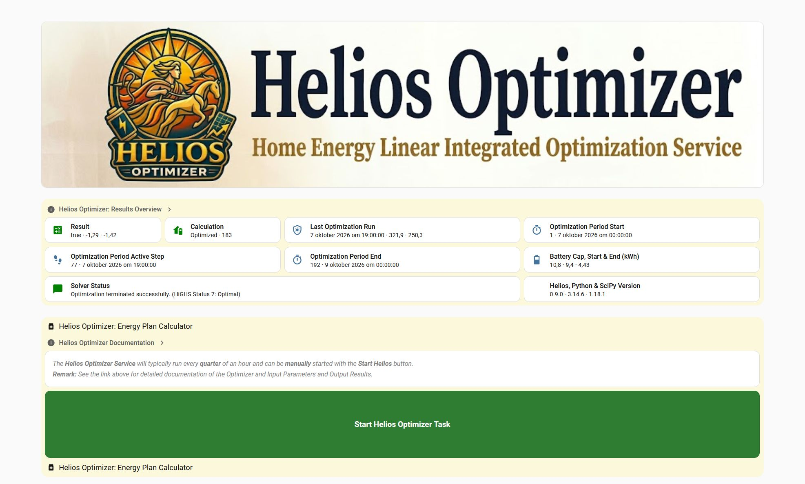

# Helios Optimizer - Installation


## Installation
- **Prerequisites for Helios Optimizer:**
  - HACS installation on your Home Assistant System
  - Home Battery Control (HBC) installation with an 'active' dynamic price datasource
    <br>Helios retrieves the dynamic import prices from HBC and uses it to calculate the related market and export prices.
    <br>Only when a dynamic price strategy (Dynamic or Helios) is 'active' the HBC Price Data will be refreshed!
  - Forecast.Solar Integration Installation and Configuration 
    <br>WARNING: Currently ONLY Forecast.Solar is supported as a Solar Forecast!
  - File Editor (or Samba) via HACS: to create folders and upload files
  - PyScript installation via HACS with imports and hass access enabled:
    - Integrations: Pyscript Python scripting - pyscript - [Configurate]
      - V Allow All Imports?
      - V Access hass as a global variable?
      - _ Use legacy decorators? (Not required)
  - For the Helios Dashboard (UI-components)
    - ApexCharts Card (via HACS)
    - card-mod (via HACS)
    - Markdown Card (built-in)
    - Picture (built-in) for /local/HeliosOptimizerBanner.jpeg in www-folder
    
- **Download and Copy the Helios Optimizer files:**
  - Download on [GitHub](https://github.com/Jos1958/ha-helios-optimizer/releases/tag/0.9.0)
  - Unpack the ha-helios-optimizer-0.9.0.zip file 
  - Use the File Editor or Samba to copy the following files (with a **V**) to Home Assistant installation.
  - Create the folders (with a **!**) when they do not exist: packages, pyscript, helios_python (sub-folder), export and www
  - Remark: The Dashboard and Automation files are only templates for your HA dashboard and automation and do not need to be copied!

  - File Structure on GitHub:

```
  -[HomeAssistant]                     - Already exist for your HA installation (sometimes called: [config]):
  !  [packages]
  -    house_battery_control.yaml      - Home Battery Control (HBC) package file (must already exist, Helios Strategy will be added)
  V    helios_optimizer.yaml           - Helios Templates, Input Numbers and Selects
  -    helios_optimizer_config.yaml    - forecast.solar REST API and Template <== This file is not needed any more !!!!
  !  [pyscript]
  V    helios_services.py              - Helios Services file which defines the Helios Optimizer Services 
  V    helios_forecast.py              - Helios Forecast file which retrieves the Helios Solar Forecast from the Forecast.Solar Integration
  !    [helios_python]
  V      helios_optimizer.py           - Optimizer with the Calculation of the Energy Plan (Pure Python functions)
  V      helios_common.py              - Common Python functions for Helios Optimizer
  V      helios_prices.py              - Energy Price Parser Class (for HBC Price and Provider Price Data)
  !  [www]
  V    HeliosOptimizerBanner.jpeg      - banner picture for the Dashboard 
  -  [custom_components]               - Probably already exist for other Custom Components
  -    [helios_optimizer]              - This is for the future version as a Custom Component (not needed yet)
  !  [export]                          - This folder must exist for the output files of the optimizer!
  -    helios_optimizer_params.json    - optional input  file for debugging (generated by Helios)
  -    helios_optimizer_payload.json   - optional output file for debugging (generated by Helios)
  -    helios_optimizer_table.csv      - optional energy plan file for debugging (generated by Helios)
  -  [node-red]                        - this is NOT a Home Assistant Folder (see below what to do with it)
  -    02 strategy-helios-vx.xx.x.json - contains the helios strategy flow for Node-RED    
  -  [dashboard]                       - this is NOT a Home Assistant Folder (see below what to do with it)
  -    helios_dashboard.yaml           - contains the helios dashboard
```

- Check the **configuration.yaml:** Include packages and allow external dirs
<br>Make sure that the packages folder is included in your configuration.yaml (already needed for HBC) and allow for external directories (/config/export).
<br>Helios will write output files (for debugging and testing purposes) to the export folder (not sure if this configuration is needed for pyscript).
```
  homeassistant:
    packages: !include_dir_named packages
    allowlist_external_dirs:
      - /config/export    
```

- **Helios Optimizer Dashboard:** Create a **New** or **Add to** the **HBC** Dashboard
  - Create a **New** Dashboard:
    - Home Assistant - Settings (Instellingen) - Dashboards - [Add Dashboard] empty dashboard
    - Specify:
      - Title (e.g. Helios Optimizer,
      - Icon (e.g. mid:shield-sun-outline)
      - URL (e.g. helios-dashboard), 
      - Select: Add to Home Assistant Sidebar 
      - [Create]

  - Select the **New** Dashboard or the **HBC** Dashboard in the HA Sidebar
  - Edit the Dashboard in YAML mode
  - Open dashboard/helios_dashboard.yaml in your local Editor 
  - Select all content of the helios_dashboard.yaml file 
  - For a **New** Dashboard: Copy/Paste all of the content to the Yaml editor (**replace all existing** lines of the new dashboard including the first line with 'views:')
  - Alternative for adding to the **HBC** Dashboard: Copy/Paste the content **at the bottom** of the HBC Dashboard yaml 
    but **exclude** the line with 'views:' since it is already at the top of the HBC dashboard!
  - [Save] the Dashboard yaml

- **HBC Helios Strategy:** Add the Helios Strategy
  - Create a new Node-RED flow for Helios Strategy:
    - Select "Node-RED"in the HA Sidebar
    - In the Node-RED Menu (right top) - Select "Import"
    - Press "Select a file to import" 
    - Goto the Helios download folder "node-red" and select "02 strategy-helios.json" and press [Open]
    - Select "new flow" (or "current flow" when your updating) and press [Import] 
    - If you get a message: "Some of the nodes you are importing already exist in your workspace"
      - Press [View nodes..]
      ```
      Flows:
      V > Strategy Helios v4.15.1
      _   Home Assistant  ! _ replace
      ```
    - Do **NOT** change the selections/checks!
<br>  Leave the "Strategy Helios" **checked** and leave "Home Assistant" **unchecked**.  
<br>  Your existing Home Assistant Server connection will be automatically used by the helios nodes!
    - Press [Import Selected]
    - Press [Deploy] 
  
  - Add Helios to the House Battery Strategy entity options:
    - Use the File Editor in Home Assistant
    - Open the folder:  "packages"
    - Open the file: "house_battery_control.yaml"
    - Search for "house_battery_strategy:"
    - Add an extra option to the existing options of the house battery strategy entity:
      - Helios # Requires a dynamic tariff contract, the Cheapest Hours HACS add-on and the Helios Optimizer Installation
    - [Save] the file "house_battery_control.yaml"

- Restart you Home Assistant after these changes  

- Select the Helios Strategy in HBC
  - Goto the HBC Home Page
  - Under "Master Battery Control" - "Choose strategy" - Select "Helios" from the dropdown

- Check the Helios Optimizer Dashboard (within 10s after restart the automation should run).
- Adapt the Optimization Parameters and the Battery Parameters to your needs
  - Steps: 48 or 192 with Step Size: 60 or 15 minutes and Start Step: 0 (for Automatic)
    <br>The preferred optimization horizon is 2 days (48 x 60m or 192 x 15m)!
    <br>Use only a specifiy start step for simulation/test runs!
  - House Daily Usage (e.g. 10.0 kWh) 
  - House Daily Usage Distribution (e.g. [ 1, 1 ,1, 1, 1, 1, 1, 3, 3, 2, 2, 2, 3, 2, 2, 2, 2, 3,12,12, 8, 8, 3, 1])
  - Max Grid Import and Export: 11.0 kWh (2x)
  - Battery Enabled: On (or Off when you do not have a battery)
  - Battery SOC Target: 40%-50% (to be left for the rest of the night at the end of the optimization period, usually end of the day tomorrow)
  - Battery SOC Min and Max (e.g. 10% and 90%, depending on your battery requirements)
  - Battery Charge and Discharge Limit (e.g. 1.2kWh, total limit, depending on your battery configuration)
  - Battery Charge and Discharge Efficiency (2x 0.9 for a RTE of 81%)
- Rerun the automation using the green button ("Start Helios Optimizer Task")
- The button will turn yellow (at least 1 sec) while the Helios Optimizer is running
- Check out the results in the Results Overview and the Optimized Energy Plan (as a Graph and as a Table)
  <br>Especially check the 'Result' and the 'Solver Status' boxes on the Results Overview!
  <br>The 'Solver Status' will display an error/exception message if the Optimizer failed.
  <br>Refresh the browser page (Ctrl-F5) if the graph is not yet displayed.
- The Current Values (for the Active Step) can be found in the 'Actuals' section

- **Important Remark:** Only when you select the **Helios** or the **Dynamic** Strategy in **HBC** the HBC Price Data will be generated.
<br>Helios will still run with other strategies selected in HBC but will have no (recent) price data available.
<br>HBC will only apply the plan calculated by Helios as a Sub-Strategy when you select the **Helios** strategy in HBC!




  
- **HACS:** 
  * Not supported yet (see Helios Calculator)

[README](README.md) - [Doc](DOC.md) - [Why LP](WHY.md) - **Install** - [Release Notes](RELEASE_NOTES.md)
