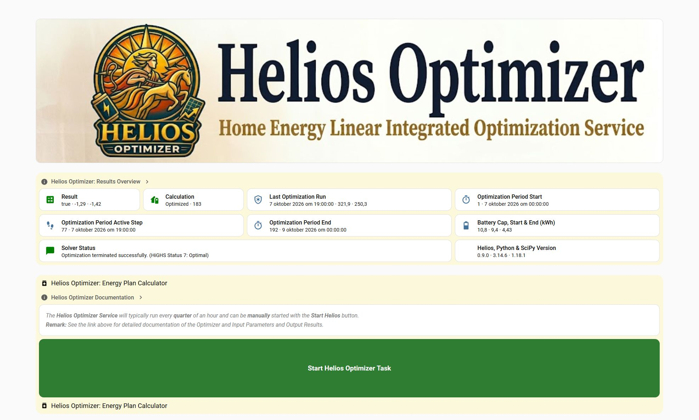

# Helios Optimizer - Installation

[README](README.md) - [Doc](DOC.md) - [Why LP](WHY.md) - **Install** - [Release Notes](RELEASE_NOTES.md)

## Installation
- **Prerequisites for Helios Optimizer** (Before the Helios Installation):
  - **HACS** installation on your Home Assistant System
  - **Home Battery Control (HBC)** installation with an 'active' dynamic price datasource
    <br>Helios retrieves the dynamic import prices from HBC and uses it to calculate the related market and export prices.
    <br>Only when a dynamic price strategy (Dynamic or Helios) is 'active' the HBC Price Data will be refreshed!
  - **Forecast.Solar** Integration Installation and Configuration for your Solar Panels
    <br>**WARNING**: Currently ONLY Forecast.Solar is supported as a Solar Forecast (Solcast support is expected soon)!
    <br>For Forecast.Solar: Check that sensor.energy_production_today and sensor.energy_production_tomorrow contain valid values.
  - **File Editor** (or Samba) via HACS: to create folders and upload files
  - **PyScript** by @craigbarratt [installation via HACS](https://github.com/custom-components/pyscript) with **Imports** and **hass** access enabled:
    <br>**VERY IMPORTANT:** The Helios Optimizer PyScript Application **CANNOT** run without these options enabled!
    - Integrations: Pyscript Python scripting - pyscript - [Configurate]
      - **V** Allow All Imports? (Mandatory)
      - **V** Access hass as a global variable? (Mandatory)
      - _ Use legacy decorators? (Not required)
  - For the Helios **Dashboard** (UI-components):
    - **ApexCharts Card** by @RomRider [via HACS](https://github.com/RomRider/apexcharts-card)
    - **card-mod** by @thomasloven [via HACS](https://github.com/thomasloven/lovelace-card-mod)
    - **button-card** by @RomRider [via HACS](https://github.com/custom-cards/button-card)
    - Markdown Card (built-in)
    - Picture (built-in) for /local/HeliosOptimizerBanner.jpeg in www-folder
    
- **Download and Copy the Helios Optimizer files** (from GitHub):
  - Download the lastest version on [GitHub](https://github.com/Jos1958/ha-helios-optimizer/releases)
  - Unpack the ha-helios-optimizer-x.x.x.zip file 
  - Use the File or Samba to create folders and copy files:
    - Create the folders (See Folder Overview: **!**) on your HA installation when they do not yet exist: 
<br>  [packages], [pyscript], [helios_python] (sub-folder of [pyscript]), [www] and [export]
    - Copy the applicable files (see File Overview: **V**) to your HA installation.
  - **Remark:** Do not copy the Node-Red and Dashboard files (see below for instructions)

  - **File and Folder Overview** on GitHub:
  
```
  -[HomeAssistant]                     - Already exist for your HA installation (sometimes called: [config]):
  !  [packages]
  -    house_battery_control.yaml      - Home Battery Control (HBC) package file (must already exist, Helios Strategy will be added)
  V    helios_optimizer.yaml           - Helios Templates, Input Numbers and Selects
  -    helios_optimizer_forecast.yaml  - forecast.solar REST API and Template <== This file is optional and not needed any more !!!!
  !  [pyscript]
  V    helios_services.py              - Helios Services file which defines the Helios Optimizer Services 
  V    helios_forecast.py              - Helios Forecast file which retrieves the Helios Solar Forecast from the Forecast.Solar Integration
  !    [helios_python]
  V      helios_optimizer.py           - Optimizer with the Calculation of the Energy Plan (Pure Python functions)
  V      helios_common.py              - Common Python functions for Helios Optimizer
  V      helios_prices.py              - Energy Price Parser Class (for HBC Price and Provider Price Data)
  !  [www]
  V    HeliosOptimizerBanner.jpeg      - banner picture for the Dashboard 
  V    HeliosOptimizerBanner70.jpeg    - alternative banner picture for the Dashboard (70% height)
  -  [custom_components]               - Probably already exist for other Custom Components
  -    [helios_optimizer]              - This is for the future version as a Custom Component (not needed yet)
  !  [export]                          - This folder must exist for the output files of the optimizer!
  -    helios_optimizer_params.json    - optional input  file for debugging (generated by Helios)
  -    helios_optimizer_payload.json   - optional output file for debugging (generated by Helios)
  -    helios_optimizer_table.csv      - optional energy plan file for debugging (generated by Helios)
  -  [dashboard]                       - this is NOT a Home Assistant Folder (see below what to do with it)
  -    helios_dashboard.yaml           - contains the helios dashboard
  -  [node-red]                        - this is NOT a Home Assistant Folder (see below what to do with it)
  -    02 strategy-helios-vx.xx.x.json - contains the helios strategy flow for Node-RED    
```

- **Check the configuration.yaml** (Include packages and allow external dirs):
<br>Make sure that the packages folder is included in your configuration.yaml (already needed for HBC) and allow for external directories (/config/export).
<br>Helios will write output files (for debugging and testing purposes) to the export folder (not sure if this configuration is needed for pyscript).
```
  homeassistant:
    packages: !include_dir_named packages
    allowlist_external_dirs:
      - /config/export    
```

- **Helios Optimizer Dashboard** (Create a **New** Dashboard or **Add to** the **HBC** Dashboard):
  - Create a **New** Dashboard:
    - Home Assistant - Settings (Instellingen) - Dashboards - [Add Dashboard] empty dashboard
    - Specify:
      - Title (e.g. Helios Optimizer,
      - Icon (e.g. mid:shield-sun-outline)
      - URL (e.g. helios-dashboard), 
      - Select: Add to Home Assistant Sidebar 
      - [Create]

  - Select the **New** Dashboard or the **HBC** Dashboard in the HA Sidebar
  - Edit the Dashboard in YAML mode
  - Open dashboard/helios_dashboard.yaml in your local Editor 
  - Select all content of the helios_dashboard.yaml file 
  - For a **New** Dashboard: Copy/Paste all of the content to the Yaml editor (**replace all existing** lines of the new dashboard including the first line with **views:**)
  - Alternative for adding to the **HBC** Dashboard: Copy/Paste the content **at the bottom** of the HBC Dashboard yaml 
    but **exclude** the line with **views:** since this line is already available at the top of the HBC dashboard!
  - [Save] the Dashboard yaml

- **Helios Strategy for HBC** (Add the Helios Strategy to the HBC Strategies):
  - Create a new Node-RED flow for Helios Strategy:
    - Select "Node-RED"in the HA Sidebar
    - In the Node-RED Menu (right top) - Select "Import"
    - Press "Select a file to import" 
    - Goto the Helios download folder "node-red" and select "02 strategy-helios-vx.xx.x-vy.y.y.json" and press [Open]
    - Select "new flow" (or "current flow" when your updating) and press [Import] 
    - If you get a message: "Some of the nodes you are importing already exist in your workspace"
      - Press [View nodes..]
      
      ```
      Flows:
      V > Strategy Helios v4.15.1
      _   Home Assistant  ! _ replace
      ```
    - Do **NOT** change the selections/checks!
      <br>Leave the "Strategy Helios" **checked** and leave "Home Assistant" **unchecked**.   
      <br>Your existing Home Assistant Server connection will be automatically used by the helios nodes!

    - Press [Import Selected]
    - Press [Deploy] 
  
  - **Add Helios to the HBC House Battery Strategies** (In the HBC configuration):
    - Use the File Editor in Home Assistant
    - Open the folder: **"packages"**
    - Open the file: **"house_battery_control.yaml"**
    - Search for "house_battery_strategy:"
    - Add an **extra option** to the existing options of the **input_select.house_battery_strategy** entity:
      - Helios # Requires a dynamic tariff contract, the Cheapest Hours HACS add-on and the Helios Optimizer Installation
    - [Save] the file "house_battery_control.yaml"
    - **WARNING:** Repeat this step after each **upgrade** installation of HBC!

- **Restart** Home Assistant

- **Select the Helios Strategy** (in **HBC**):
  - Goto the HBC Home Page
  - Under "Master Battery Control" - "Choose strategy" - Select "Helios" from the dropdown
<br>If you want to start with a test of Helios in read-only mode.
Select the "Dynamic" strategy in HBC, this will generate the HBC Price Data.
Now you can continue in the next step but HBC will still apply the dynamic sub-strategies.  

- **Check the Helios Optimizer Dashboard** (within 8s after restart the automation should run):

- **Adapt the Optimization Parameters and the Battery Parameters** (on the Helios Dashboard):
  - Step Size (60 or 15 Minutes), Start with 60 minutes this will work also when you have 15 minutes dynamic prices
  - House Daily Usage (e.g. 10.0 kWh) 
  - Max Grid Import and Export: 11.0 kWh (2x)
  - Battery Enabled: On (or Off when you do not have a battery)
  - Battery SOC Target: 40%-50% (to be left for the rest of the night at the end of the optimization period, usually end of the day tomorrow)
  - Battery SOC Min and Max (e.g. 10% and 90%, depending on your battery requirements)
  - Battery Charge and Discharge Limit (e.g. 1.2kWh, total limit, depending on your battery configuration)
  - Battery Charge and Discharge Efficiency (2x 0.9 for a RTE of 81%)

- For **advanced** configuration use the **'Helios Insights Mode'** button to make additional input parameters and output results visible (or to hide).

- **It is not necessary to adapt any of the Advanced Parameters for your first runs**:
  - Steps: 48 or 192 with Step Size: 60 or 15 minutes and Start Step: 0 (for Automatic)
    <br>The preferred optimization horizon is 2 days (48 x 60m or 192 x 15m)!
    <br>Use only a specifiy start step for simulation/test runs!
  - House Daily Usage Distribution (e.g. [ 1, 1 ,1, 1, 1, 1, 1, 3, 3, 2, 2, 2, 3, 2, 2, 2, 2, 3,12,12, 8, 8, 3, 1])
  - Price Source Data parameters (changes only needed when you have generic market prices in HBC instead of provider prices).
  - **Prices** used by Helios per step can be checked in the Optimal Energy Plan Table.
    <br>If the prices are not as expected then you may need to adapt **price type**, **data provider** and/or **energy provider**.
  
- **Run Helios Optimizer** (using the green button "**Start** Helios Optimizer Task"):
  - The button will turn yellow (at least 1 sec) while the Helios Optimizer is running.
  - Check out the results in the Results Overview and the Optimized Energy Plan (as a Graph and as a Table)
    <br>Especially check the 'Result' and the 'Solver Status' boxes on the Results Overview!
    <br>The 'Solver Status' will display an error/exception message if the Optimizer failed.
    <br>Refresh the browser page (Ctrl-F5) if the graph is not yet displayed.
  - The *Current* Values (for the Active Step) can be found in the 'Actuals' section.

- **Important Remark:** Only when you select the **Helios** or the **Dynamic** Strategy in **HBC** the HBC Price Data will be generated.
<br>Helios will still run with other strategies selected in HBC but will have no (recent) price data available.
<br>HBC will only apply the plan calculated by Helios as a Sub-Strategy when you select the **Helios** strategy in HBC!


  
- **HACS:** 
  * Not supported yet (see Helios Calculator)

## Upgrade
See the [Helios Optimizer Release Notes](RELEASE_NOTES.md) for a list of the **updated files** per Helios release.
<br>Depending on the release(s) you may have to perform the following steps for update files
(do not forget to check earlier releases when you skip a release or just update all files):

- **Package** File (\*.yaml): Copy the updated file to /packages

- **PyScript** File(s) (\*.py): Copy the updated file(s) to /pyscript and/or /pyscript/helios_python

- **www (banner)** Files: Copy the update file(s) to /www

- **Dashboard** File (helios_dashboard.yaml): 
Edit the Dashboard using the 'Raw Configuration Editor' and copy/paste the updated yaml file content over the existing helios content.
<br>See the instruction in the installation for what to do with the **views:** line (when adding to the HBC Dashboard).

- **Node-Red** Helios Strategy Flow File (02 strategy-helios-vx.xx.x-vy.y.y.json):
  - Delete the existing Strategy Helios vx.xx.x in Node-Red
  - Import the updated flow file again into Node-Red (see the instructions in the installation above)
  - Press [Deploy] after importing the flow!
  

- **Restart** Home Assistant after the updates

## Upgrade of HBC
- **Add Helios to the HBC House Battery Strategies**:
<br>This step is **NOT** needed for an update of the **Helios Optimizer** but is **needed** for an update of a **HBC** release with an updated **house_battery_control.yaml** file!  
