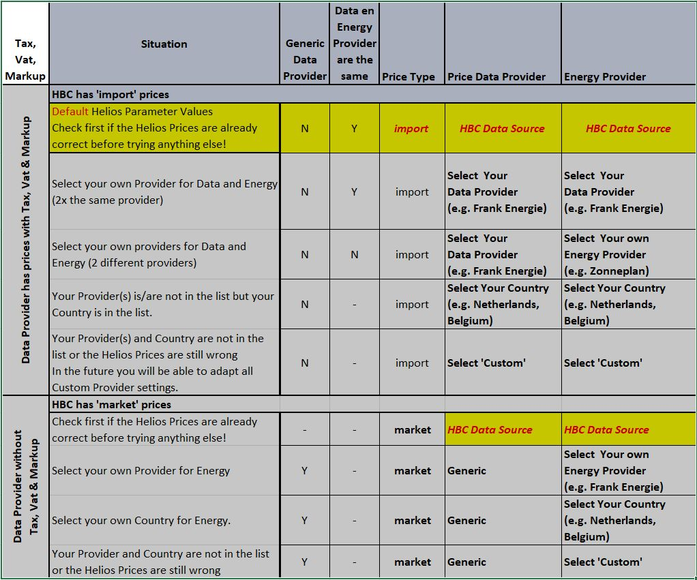

# HA Helios Optimizer - Frequently Asked Questions
Sometimes you will need to use the advanced sections to configure the Helios Optimizer.
Advanced Input and Output Sections are only visible when 'Helios Insights Mode' is enabled.
You can enable this mode with a button at the top of the Helios Dashboard Tabs.
HBC also has an "Insights Mode" for the same purpose but these modes are independent.

## Helios Installation Problems
Always check the detailed [Installation Guide](../INSTALL.md) when you are having problems with the simple installation in the [README](../README.md) file.
- **Invalid Configuration** for the Dashboard
 If you have created a **new** Helios Dashboard make sure the yaml starts with **views:**
 If you have added the Helios yaml to the **HBC** Dashboard, make sure the Helios yaml part does **not** start with **views:**.
The HBC Dashboard yaml should start with **views:** at the top of the configuration.
 Indentation is very important for the yaml, make sure the indentation is exact as in the source of the yaml
(Check on extra or missing spaces).

- **Configuration Error** for the Dashboard
 Make sure that all pre-requisites are installed (ApexCharts Card, card-mod and button-card) as specified in the installation guide.

- '**Action pyscript.helios_optimizer_hbc_task not found**' is displayed when I press the green **Start** button
 Make sure that you have copied all the **\*.py files** to the **/pyscript** and **/pyscript/helios_python** folders on your Home Assistant Server.
 Make sure that you have installed the prerequisite PyScript with the required configuration (for imports and hass) as specified in the installation guide.
 Restart the Home Assistant Server after installing py files and after changing the PyScript configuration.

- Helios displays a Solved Status: **PyScript Import(s) Failed!** 
 Helios needs 'Allow all imports' to be enabled in the PyScript configuration. 
Adapt the PyScript configuration as specified in the installation guide.

- Helios displays a Solved Status: **Hass is NOT accessable by PyScript!**
 Helios needs 'Access Hass as a global variable' to be enabled in the PyScript configuration. 
Adapt the PyScript configuration as specified in the installation guide.

- Helios displays a Solved Status: **Solar is enabled but the Solar Energy Forecast is not available (Empty)!**
 Helios needs a Forecast.Solar configuration. 
Make sure to configure the Forecast.Solar for your location (Declination, azimuth, total peak power).
You can check in HBC if solar forecasts for today and tomorrow are available.
Helios will use a service of Forecast.Solar to retrieve the hour forecast for today and tomorrow.
 Please note that **Forecast.Solar** and **Solcast** are **not** the same and are both supported by HBC.
At the moment you need a working **Forecast.Solar** configuration but in the near future **Solcast** will be supported.

- Helios reports an invalid parameter in **Solved Status**
 Adapt the specified parameter in the Optimization, Battery and/or Advanced Parameters Sections.

- Helios displays another **error/exception** in **Solved Status**
 Try to fix the error but in case of an exception you can report an issue for helios.

## Strange Behaviour of the Strategy in Helios Optimizer
- **Unexpected Selling/Discharging** of Energy from the Battery to the Grid
 The Model follows the rules you have set for the Maximum State of Charge of the Battery very strict.
If the Battery SoC is above the SoC-Max then it will start selling at any price.
 Adapt the Helios input parameter for the SoC-Max or adapted the maximum SoC in HBC to be inline then this situation will no longer occur.

- **Unexpected Buying/Charging** of Energy from the Grid to the Battery
 The Model follows the rules you have set for the Minimum State of Charge of the Battery very strict.
If the Battery SoC is below the Soc-Min then it will start buying at any price.
 Adapt the Helios input parameter for the SoC-Min or adapted the mininum SoC in HBC to be inline then this situation will no longer occur.

- **Not Selling at the Highest Price**
 When using the HBC dynamic strategy you may be used to selling at the highest price. 
However when calculated over a two day period it may be cheaper to keep the energy in the battery for a later moment.
Especially when the Energy Tax is no longer compensated in the Netherlands in 2027.
For 2026 you can enable 'Net Metering' in the advanced parameters (Helios Insights Mode).
As a result the difference between import and export price will be much smaller and the Optimizer will buy and sell more often.
When disabled you will notice that 'Self consumption' becomes a more preferred strategy.

- **Unexpected Strategy selected by Helios**
 Helios uses a different approach for determining the best strategy for the optimization period than you may be used to.
There are no rules in the model that define which strategy must be selected (no if-then-else logic based on lowest or highest prices). Instead, the model only contains the physical limits (max grid import/export, max battery charge/discharge, battery capacity, min/max SoC%) and the current system state (battery SoC%).
It calculates a solution for the variables (grid power and battery power) that yields the lowest total cost for the entire 24–48 hour horizon. Its inputs are the solar production forecast, the house demand forecast, and the dynamic price data.
Rather than guessing, it uses an open-source Linear Programming module specifically designed to solve these complex mathematical problems globally.
While you might sometimes question why a specific strategy is chosen for a single hour, you should always look at the bigger picture—what is cheapest over the full 24–48 hour period. The best way to verify if the model is making the right choice is to construct an alternative strategy and calculate the total grid cost for it under the exact same circumstances (same forecasts and prices). If your alternative results in a lower total cost, your approach is better; otherwise, the model has found the true mathematical optimum.

- Battery is **enabled** in the **Input** Parameters for the Battery but in the **Results** the Battery is **disabled**.
 For a Battery Capacity of 0 the Battery will be disabled and no Battery Results will be available.
 You can verify using 'Helios Insights Mode' in the Derived Parameters section (field: Maximum Energy (All Batteries)) the value of Battery Capacity as used in Helios.
This value is calculated using a Helios Template but based upon the HBC/Marstek Battery Entities.

- **Prices** in Helios Optimizer are **not correct**.
  - Helios Dynamic Prices are **based on** the HBC Dynamic Prices (See entity 'sensor.hbc_energy_prices_data'). 
   You **cannot expect** valid prices in Helios when you do **not** have a **working Dynamic Strategy** with **valid** prices in **cents/kWh**.
  Make sure the price unit in HBC is **cents/kWh** since the HBC to Helios price factor cannot be changed!
  - Use the 'Timed/Dynamic' tab in HBC with 'Insights mode' enabled and **verify** the **HBC prices** in the 'Price marks visualisation' Table.
  - Use the 'Detailed Results' tab in Helios and **verify** the **Helios (import, export and market) prices** in the 'Optimal Energy Plan' Table.
  - Helios assumes as a default that the prices in HBC are **import** prices (including Energy Tax, VAT and provider Markup).
   You may have to change the **Price Type** in the Advanced parameters section to select **market** or **export** depending on the prices available in HBC.
  - Helios assumes that the Data Provider and the Energy Provider are the same as the **HBC Data Source**.
   First try the **default** options and check out the resulting **Helios prices**.
   When the helios prices are **not correct** you may want to check other options:
    - When you have a data provider with market prices (without Tax, Vat and provider markups) you want to use 'Generic' as Data Provider
    - Select your **own** **provider** or your **country** as the **energy** provider
    - Select **'Custom'** as **energy** provider when your **own** **provider** or **country** is not available in the dropdown list or when the prices are still wrong. In the near future each of the settings of the 'Custom' provider will be configurable on the Helios Dashboard or in a json settings file.
  - Use the table below to find the right combination more quickly (start at the top):

## Strange Behaviour of the Helios Strategy (Flow) in HBC 
- **HBC Sub-strategy 'Charge PV' is** is selected during the night (no solar).
 'Zero export' would be a better name for this strategy but this is how it is called in HBC.
The 'Charge PV' strategy has been selected by the Helios Optimizer since it prefers to use Grid Power instead of Battery Power.
The Battery will not discharge to compensate a demand of energy in the house but it
will charge when there is surplus energy available.
Of course this will not happen during the night but as soon as the sun start shining it may become applicable.
Effectively during the night (without solar power) it will be the same as 'Standby'. 
 
- **HBC stops Charging or Discharging** despite the strategy in Helios
 HBC always follows the limitations you have set in HBC despite what the Helios Optimizer has decided.
Make sure that your State of Charge (SoC) Minimum and Maximum for your Batteries and the 'Charge until SoC' and 'Sell until SoC'.
Be aware that Helios calculates with one big battery when you have multiple batteries.
Use the sum of the Capacity of all batteries and the sum of the SoC Minimum and SoC Maximum values to calculate an overall SoC Minimum and Maximum.
See the Derived Parameters section (Helios Insights Mode) for the (overall) Maximum Capacity, Remaining Energy and current SoC as calculated by Helios.
HBC uses a 'Available Energy' field but this value has already been compensated for the minimum and maximum SoC and is not used in Helios.

- **HBC Sub-strategy 'Full stop'** for the Helios Strategy:
 HBC goes to Sub-strategy **Full stop**. 
This means that the Node-Red Helios Flow received no value from the Helios Optimizer (value: "unknown" or "undefined").
 This can have several reasons but the main reason is that the Helios Optimizer failed to run. 
This can be due to input errors or due to installation errors.
Check the Helios Dashboard to find out if any errors are given in the "Results Summary" - "Solver Status" area and try to fix to cause of the error.
  If on the Helios Dashboard the Solver Status is "Optimization terminated successfully" then the error is not in the Helios Optimizer:
However the Helios Strategy flow could not retrieve the HBC sub-strategy from the Helios Optimizer HBC Sub Strategy
(input_select.helios_optimizer_hbc_sub_strategy). Check that this entity has the expected sub strategy value.
If the Sub Strategy value is correct then the Node-Red Flow (Strategy Helios) failed to retrieve the value.
Make sure the Helios Flow is deployed and check the status and timestamps below the individual nodes of the flow.  
Are there any errors? Which Node has the error in which section has the error?

